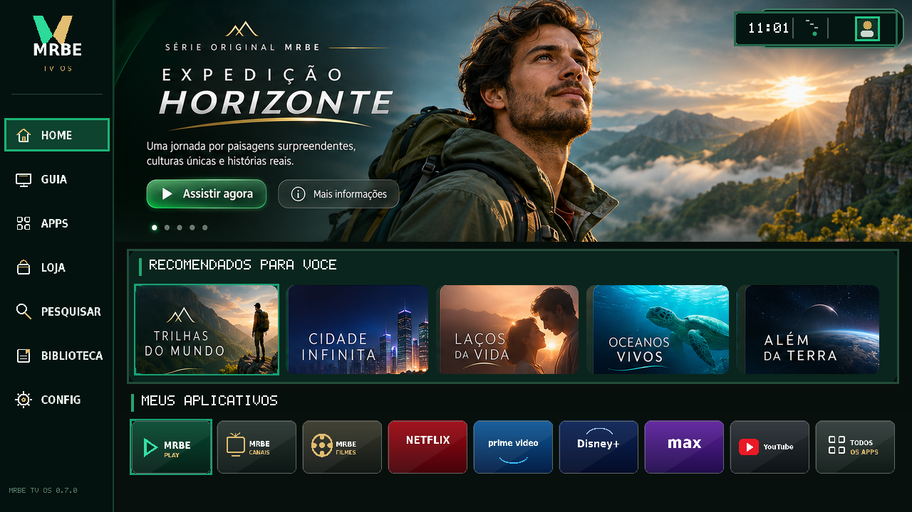

# MRBE TV OS 0.7.0

[](#estado) [](LICENSE)

Sistema Linux embarcado **experimental** para TV Box, com launcher framebuffer C e identidade visual MRBE original. A Home 0.6.0 aprovada permanece inalterada na versão 0.7.0, com arte cinematográfica, recomendações em cartões e tiles de aplicativos. O projeto é inspirado em padrões de navegação de Smart TVs, sem reproduzir a interface proprietária de Samsung/Tizen.

> **Importante:** QEMU `virt` AArch64 é uma máquina virtual de desenvolvimento, não um TV Box Amlogic. A imagem QEMU não deve ser gravada no equipamento físico.

## Executar no Windows 11 / WSL2 Ubuntu

Abra PowerShell como administrador uma vez:

```powershell
wsl --install -d Ubuntu-24.04
wsl --update
```

No Ubuntu, mantenha o projeto no filesystem Linux (`~/MRBE-Linux`), não em `/mnt/c`, para compilar mais rápido.

```bash
cd ~/MRBE-Linux
chmod +x scripts/wsl/*.sh scripts/dev/*.sh
make setup
make test
JOBS=2 make ui-rebuild
make check
make smoke
make gui
```

A janela QEMU usa 4 GiB de RAM e solicita 1280x720. Para experimentar Full HD:

```bash
DISPLAY_WIDTH=1920 DISPLAY_HEIGHT=1080 make gui
```

Se a versão do QEMU não aceitar `xres`/`yres`:

```bash
GPU_DEVICE=virtio-gpu-pci make gui
```

## Atualizar da versão 0.6.0 sem perder a compilação

1. Faça backup opcional dos fontes.
2. Extraia o pacote 0.7.0 em `~/`, permitindo sobrescrever os fontes/documentos.
3. **Não apague `work/`**: ela contém a saída/cache Buildroot local.
4. Execute `make test && JOBS=2 make ui-rebuild && make check && make smoke && make gui`.

## Home visual preservada na versão 0.7.0

- Hero cinematográfico com título, ações e status superior.
- Cinco artes de conteúdo recomendado.
- Nove tiles: MRBE Play, MRBE Canais, MRBE Filmes, Netflix, Prime Video, Disney+, Max, YouTube e Todos os apps.
- Menu lateral de sete destinos com ícones e rótulos antialias.
- Navegação por controle remoto/teclado e mouse.
- Assets instalados no rootfs em `/usr/share/mrbe/ui/`.
- Smoke test exige confirmação explícita de que os assets foram carregados.

Netflix, Disney+, Prime Video e Max continuam como tiles demonstrativos: não há APK, DRM/Widevine nem reprodução oficial neste Linux/QEMU.

## Estado

Os testes host verificam compilação C, lógica de navegação, assets e prévias. O boot ARM64/QEMU 0.7.0 ainda precisa ser reconstruído e validado no WSL do usuário.

Consulte [STATUS.md](STATUS.md), [MANIFEST.md](MANIFEST.md) e [Home cinematográfica 0.6.0](docs/25-HOME-CINEMATOGRAFICA-0.6.0.md).

## Documentação por fase
- [Guia iniciante](docs/12-GUIA-INICIANTE-0.2.md)
- [Arquitetura do boot](docs/13-BOOT-QEMU-E-HARDWARE.md)
- [Teste e aceite](docs/14-TESTES-E-EVIDENCIAS.md)
- [Hardware MXQ Pro](docs/16-IDENTIFICACAO-MXQ-PRO.md)
- [Identidade visual 0.4.0](docs/21-IDENTIDADE-VISUAL-0.4.md)
- [Implementação 0.5.1](docs/24-IMPLEMENTACAO-0.5.1.md)
- [Home cinematográfica 0.6.0](docs/25-HOME-CINEMATOGRAFICA-0.6.0.md)
- [Estabilidade e APIs 0.7.0](docs/26-ESTABILIDADE-APIS-0.7.0.md)
- [Roadmap](docs/18-ROADMAP.md)
- [Segurança e licenças](docs/19-SEGURANCA-E-LICENCAS.md)



[Ver sequência completa das telas](docs/preview-mrbe-sequence.png)


## Diagnósticos de API e estabilidade (0.7.0)

No QEMU, após o boot:

```sh
mrbe-healthcheck
mrbe-api-test
MRBE_STABILITY_DURATION=300 mrbe-stability-test
```

O teste de API usa por padrão um endpoint público de demonstração JSONPlaceholder. Para testar outra API GET:

```sh
MRBE_API_URL="https://seu-endpoint/health" \
MRBE_API_EXPECT_PATTERN='"status"[[:space:]]*:[[:space:]]*"ok"' \
mrbe-api-test
```

A validação TLS permanece habilitada. Não use `curl -k` em produção. Nenhum endpoint comercial, token ou chave de API foi fornecido/configurado nesta versão.

No host, `make api-test` executa testes HTTP determinísticos contra um servidor local simulado; `make test` executa a suíte completa.
